# EarthBound Companion

**Native EarthBound for Windows, with Linux, macOS and Android community previews. Includes a MaternalBound Redux adaptation, widescreen and ultrawide scenery, 1080p–4K output, MSU music, keyboard and controller support, save recovery, Story Shuffle v4 and 46 offline achievements.**

## Platforms and latest downloads

| Platform | Latest release | Package to choose |
|---|---|---|
| Windows x64 | [Companion 1.0.14](https://github.com/rages4calm/earthbound-companion/releases/latest) | Windows ZIP — official release |
| Linux x64 / SteamOS | [Platform preview.25](https://github.com/rages4calm/earthbound-companion/releases/tag/v0.5.0-ports-preview.25) | `linux-x64` archive |
| macOS Apple Silicon (ARM64) | [Platform preview.25](https://github.com/rages4calm/earthbound-companion/releases/tag/v0.5.0-ports-preview.25) | `osx-arm64` archive |
| macOS Intel (x64) | [Platform preview.25](https://github.com/rages4calm/earthbound-companion/releases/tag/v0.5.0-ports-preview.25) | `osx-x64` archive |
| Android ARM64 handhelds/phones/tablets | [Platform preview.25](https://github.com/rages4calm/earthbound-companion/releases/tag/v0.5.0-ports-preview.25) | `android-arm64` APK — ROM setup on the device |
| Android x64 | [Platform preview.25](https://github.com/rages4calm/earthbound-companion/releases/tag/v0.5.0-ports-preview.25) | `android-x64` APK — emulator testing |

Linux, macOS and Android builds are **community previews**; full playthroughs and broader device testing are still pending. Linux requires glibc 2.38+, macOS requires 12+, and Android requires 8.0+. macOS previews are not notarized. [Platform setup, features and testing limits](docs/PORTABILITY.md).

Desktop and Android builds set up Original and Redux from your own clean USA ROM. **Android no longer needs a computer first:** choose **Set up Original from ROM** or **Set up Redux from ROM** on the device. Importing existing asset packs remains available. No release includes a ROM or game assets. External Slang shader presets are currently Windows-only.

[▶ Watch the EarthBound Companion + MaternalBound Redux trailer](https://youtu.be/RZ5UdAxyqdY)

**Discord contact:** `chrono.trigger`

> [!NOTE]
> **Community platform previews:** Linux x64/SteamOS, macOS Apple Silicon/Intel and Android ARM64/x64 share the native game core, settings, Story Shuffle and achievements. [Linux/macOS preview.25](https://github.com/rages4calm/earthbound-companion/releases/tag/v0.5.0-ports-preview.25) · [Android preview.25](https://github.com/rages4calm/earthbound-companion/releases/tag/v0.5.0-ports-preview.25) · [setup and coverage](docs/PORTABILITY.md). Android handheld users can hide the touch overlay in **Controls → Show touch controls**. New-platform gameplay still needs community testing.

> [!NOTE]
> **1.0.14 maintenance release — the supported feature set is complete.** Setup failures now produce a shareable error report with full helper output. Android utility buttons move to the sides and take less visual space. Earlier fixes are retained. [Release notes](docs/RELEASE-1.0.14.md) · [Scope and coverage](MAINTENANCE.md) · [Report a bug](https://github.com/rages4calm/earthbound-companion/issues/new?template=bug-report.yml).

> [!NOTE]
> **Windows 1.0.6 / platform preview.18 fix battle color blending and per-layer distortion in both editions, plus Redux death/retry cinematic bars and escalator running poses.** It supports Original EarthBound and Companion's pinned native MaternalBound Redux adaptation. The owner completed Redux through the credits, with equipment/stat boosts for final testing; community testers also report completing both editions. The Redux input remains `897d0083`, rather than automatically following newer upstream changes. Exhaustive campaign parity, full randomized progression and every combat/music combination remain unverified. [Redux version and coverage](MATERNALBOUND-NATIVE.md).

Android preview.19 replaces the arrow grid with a sliding eight-way thumbstick and a cleaner touch overlay. Hold Run or an action with another finger; controller users can still hide everything in **Controls → Show touch controls**.

For a stable wide view through conversations and menus, keep **Wide FOV On**. Android preview.15 fixed the touch Settings button accidentally selecting close-up zoom. If the old button already zoomed you in, open the game's own **Set Up → Wide FOV** and switch Off, then On once to restore the wide view. [Details and focused checks](docs/RELEASE-1.0.4.md).

1.0.1 keeps NPCs and foreground scenery in their own camera coordinates, preserving opaque outlines when Ness passes behind them. The opening Onett pan now uses fractional scrolling, and fast-forward leaves music playing at normal speed. [Fixes and focused checks](docs/RELEASE-1.0.1.md).

Dev.38 corrects Redux battle portrait padding and priority so the lower body stays behind the HP/PP box. Reported by **raid_rgb on Discord**. [Fix and focused checks](docs/RELEASE-dev38.md).

Dev.37 preserves shared black sprite outlines during overlap and removes the remaining scenery jump during scripted event fades. Ordinary building transitions and dialogue keep their smooth scrolling. [Fix and focused checks](docs/RELEASE-dev37.md).

Dev.35 fixes the slight overworld camera jump when conversations and textboxes open or close. The smooth scenery offset is retained while text stays at fixed screen coordinates. [Fix and focused checks](docs/RELEASE-dev35.md).

Dev.34 adds **46 offline achievements** across the story, all Sanctuaries, photography and battle goals, with native popups and a launcher list. Existing pilot unlocks and saves are preserved. [Full set and progress rules](docs/ACHIEVEMENTS.md) · [Focused checks](docs/RELEASE-dev34.md).

Dev.36 fixes sprite-overlap masks and ordinary door/fade camera jumps, adds controller hold-fast-forward, and puts the achievement list inside **Set Up** with earned icons and an optional unlock chime. [Update and focused checks](docs/RELEASE-dev36.md).

Dev.33 corrects fractional camera scrolling and frame pacing, extends enemy spawning to the widescreen viewport, and adds optional Slang finishing shader presets. [Changes and focused verification](docs/RELEASE-dev33.md).

Dev.32 broadens Story Shuffle: ordinary gifts and drops mix item types, priceless equipment enters the loot pool, shop baselines can change, and wild encounters now change enemy lineups. Story keys, quest helpers, required trade supplies and scripted boss lineups remain intact. V3 recipes still reproduce their original algorithm. [Rules and verification](docs/RELEASE-dev32.md).

Dev.31 corrects the ending's party-name tile table and repairs existing packs at runtime, preserving save identities. The resumed audit now checks actual camera scripts, cold photo/cast continuations and 68 evolving battle cases. [Fix and bounded coverage](docs/RELEASE-dev31.md).

Dev.30 fixes striped/corrupted credits photographs and repeating PSI effects in widescreen side gutters, including existing checkpoints. All 32 credits photos pass in both editions. [Details](docs/RELEASE-dev30.md). Fresh public-source compilation, packaged first-run setup, 76 bounded regressions and 90 offscreen presentation cases also pass. [Readiness and remaining coverage](docs/RELEASE-READINESS-dev30.md).

## Game features

- **Standalone achievements:** 46 original local goals, an in-game list with earned icons, progress and dates, optional unlock sound, launcher categories and persistent per-edition progress. No account or server.

- **Native Windows x64 gameplay:** compiled C/SDL2 game code with a self-contained PC launcher and guided setup from your own clean USA ROM.
- **Two game modes:** original EarthBound and the pinned MaternalBound Redux native adaptation, with separate story saves.
- **Redux story and presentation:** restored writing, sprites, naming, maps, enemy/battle art, PSI effects, intro and ending presentation, plus native adaptations of the supported version's gameplay fixes.
- **Choose your title screen:** keep Redux gameplay while selecting the original EarthBound logo and animation in **Game Mode**; the Redux title remains the default.
- **HD output:** 720p, 1080p, 1440p, 4K and 3440×1440, with borderless fullscreen and a windowed option.
- **Expanded world view:** 4:3, 16:9 and 21:9 framing, wider native scenery and adjustable field of view.
- **Smooth scrolling:** fractional camera presentation and more precise Windows frame pacing, without changing movement or collision speed.
- **Finishing shaders:** Warm, Monochrome and Soft CRT presets, plus external `.slangp` files; [usage and compatibility limits](Shaders/README.md).
- **Rendering choices:** crisp pixels, Scale2x, bilinear filtering and optional integer scaling.
- **Optional visual effects:** color grading, CRT scanlines and a miniature depth effect; Enhanced, Classic, CRT and Easygoing presets.
- **Native MSU music:** installer/repair for all 164 tracks of the credited fan soundtrack, with looping, fades and one-shot jingles; missing tracks fall back to SPC music and game sound effects remain available.
- **Audio controls:** master volume and separate MSU music volume.
- **Keyboard and controller support:** rebinding, analog movement, controller hotplug, adjustable stick deadzone and Nintendo/Xbox face-button labels.
- **Sprint:** selectable Off, 1.5× or 2× movement; Redux includes its stamina, exhaustion and recovery mechanics and running sprites.
- **Faster play:** quick dialogue and configurable 2×–16× fast-forward: Tab toggles it; a bound controller button or trigger works while held. Subject to PC performance.
- **Convenience switches:** optional suppression of Ness's homesickness and Dad's unsolicited reminder calls.
- **Reward controls:** independent 1×–16× battle EXP and money multipliers, plus a one-click fast-playtest preset.
- **Redux controls and menus:** quick Talk/Check, HP/PP toggle, Town Maps and the Redux command-menu layout.
- **Expanded naming:** six-letter party names, ten-letter favorite food and Redux's accented naming keyboard.
- **Inventory conveniences:** shared key-item storage, a Keys menu and Jeff's Tools menu; eleven acquired battle Tools work without occupying his normal inventory.
- **Equipment information:** expanded stat and resistance previews, plus corrected equipment-transfer behavior.
- **Additional Redux conveniences:** expanded Spy information, bulk shop purchases and faster door transitions in Redux mode.
- **Story Shuffle v4:** cross-category gift contents, shop stock and enemy drops, rare equipment, varied ordinary-enemy stats and randomized wild lineups. Required keys/trade supplies and scripted boss lineups remain intact. Deterministic seeds, separate saves, recipes and spoilers; full randomized playthroughs remain unverified.
- **Save anywhere:** five F6/F7 quick-save banks, each with two crash-safe generations, alongside normal in-game phone saves.
- **Save recovery:** automatic session backups, guided restore, checked edition migration and separate save folders for Original, Redux and every randomizer seed.
- **PC shortcuts:** F1 settings, F9 pause, F11 fullscreen, F12 screenshots and an FPS display.
- **Native mod profiles:** import/export supported settings profiles and select compatible native asset packs. Arbitrary IPS/BPS ROM hacks need their own native adaptations.

HD describes output resolution and presentation; a replacement hand-drawn HD art pack is not included. This is an experimental build, and a complete story or randomized playthrough has not been certified. [Feature credits](CREDITS.md) · [Native conversion coverage](MATERNALBOUND-NATIVE.md) · [Exact randomizer rules](RANDOMIZER.md).

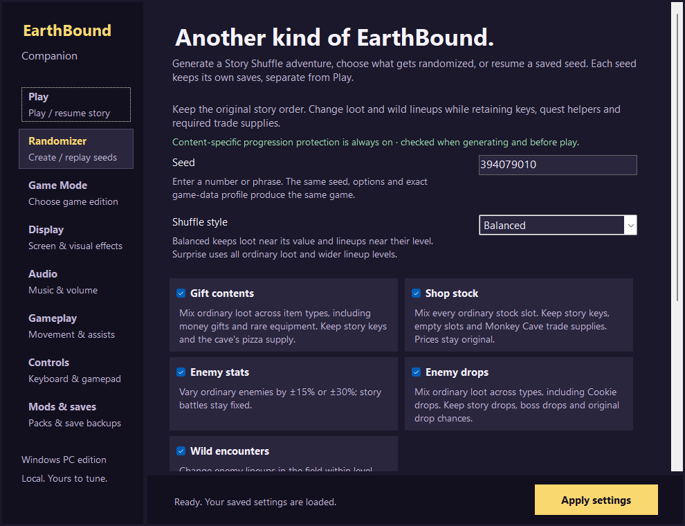

*Actual ROM-free dev.32 launcher capture. Scroll down for the wild encounter description, generation controls and seed library.*

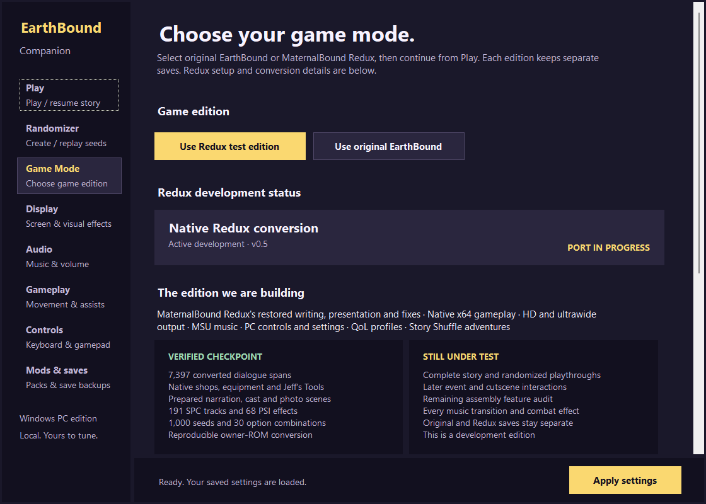

*Actual dev.19 launcher capture. Gameplay and historical screenshots below retain their stated checkpoint.*

The target is one polished PC edition: MaternalBound Redux's restored writing, art, fixes, and presentation running through the native engine alongside Companion's display, audio, input, save, QoL, mod, and randomizer features. Story Shuffle v4 binds every seed to the exact selected game version, asset hash, progression policy, and save namespace. Existing v3 recipes and saves remain supported. Both the original and the pinned Redux packs have content-specific protection policies; unknown packs cannot be randomized.

> [!IMPORTANT]
> This project does **not** contain an EarthBound ROM, extracted Nintendo assets, soundtrack audio or saves. The documentation includes clearly labeled development screenshots. You must provide your own legally obtained clean **EarthBound (USA)** ROM. Companion verifies it and builds the required native data locally. We do not condone piracy.

[Developer testing tools](docs/TESTING.md) · [Latest tester release](https://github.com/rages4calm/earthbound-companion/releases/latest) · [MaternalBound native port status](MATERNALBOUND-NATIVE.md) · [Randomizer rules](RANDOMIZER.md) · [Research and compatibility](RESEARCH.md) · [Credits](CREDITS.md) · [Source lineage](UPSTREAM.md)

Maintenance addresses reported defects in the frozen scope. Current fixes cover the completed user-reported campaign, including the museum quest, Sound Stone/Magicant presentation, Giygas artwork, credits and widescreen PSI. Historical fixes and verification scope remain in the [changelog](CHANGELOG.md) and [release evidence](docs/RELEASE-dev30.md). Untested natural story branches, randomized progression, all combat combinations and broader physical audio/display/controller coverage are documented limits, not a required broad-audit queue.

## Companion at a glance

These are real captures from the ROM-free dev.8 development launcher before game-data setup. They contain no extracted game artwork or gameplay screenshots.

<table>
  <tr>
    <td width="50%">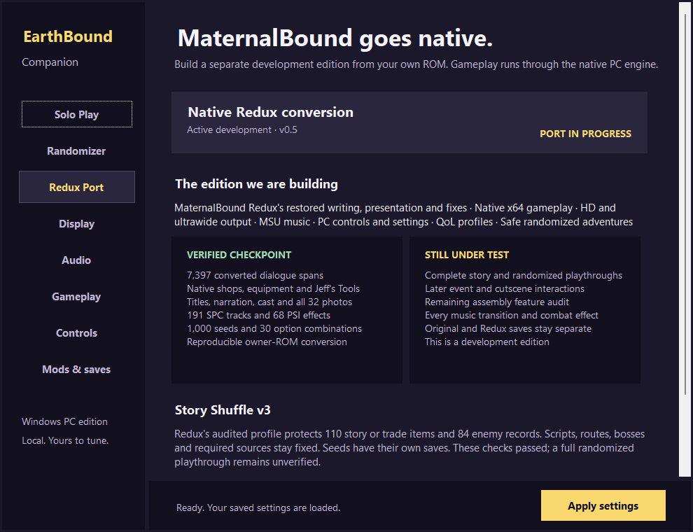</td>
    <td width="50%">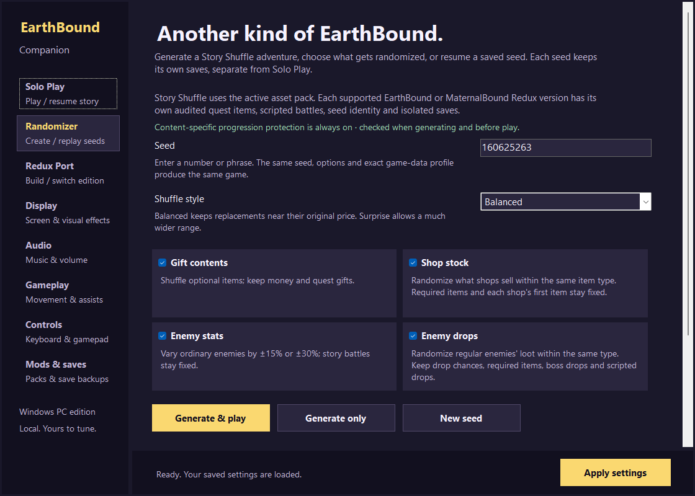</td>
  </tr>
  <tr>
    <td align="center"><strong>MaternalBound Redux native-port status</strong></td>
    <td align="center"><strong>Story Shuffle v3 content-safe randomizer</strong></td>
  </tr>
  <tr>
    <td width="50%">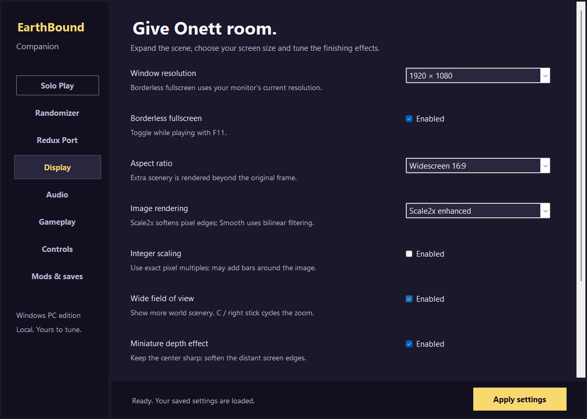</td>
    <td width="50%">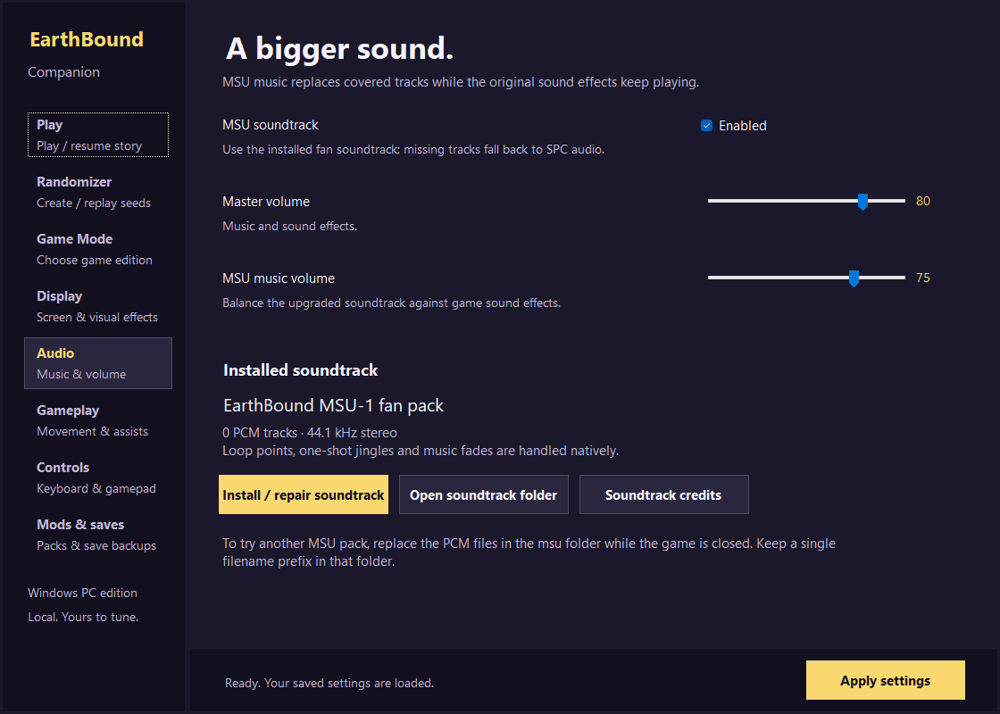</td>
  </tr>
  <tr>
    <td align="center"><strong>HD, widescreen and rendering controls</strong></td>
    <td align="center"><strong>Native MSU audio setup</strong></td>
  </tr>
  <tr>
    <td width="50%">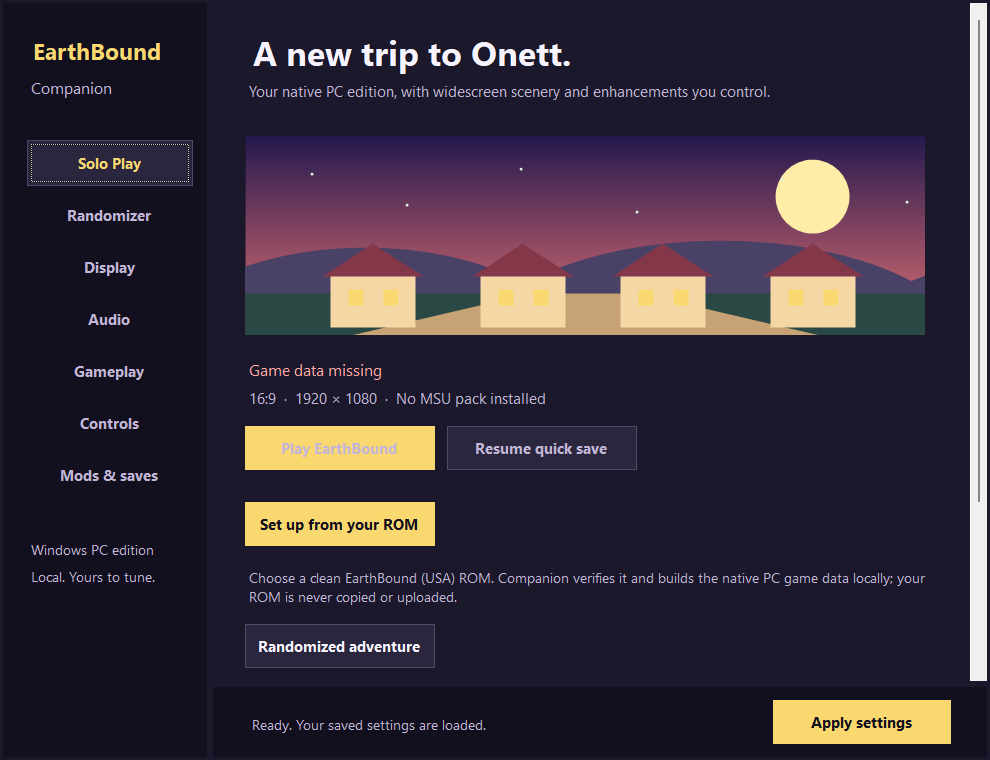</td>
    <td width="50%">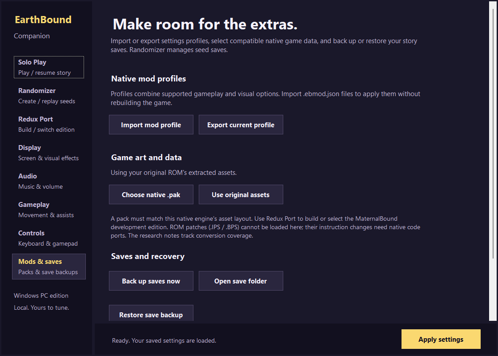</td>
  </tr>
  <tr>
    <td align="center"><strong>Guided ROM setup and Play</strong></td>
    <td align="center"><strong>Native profiles, asset packs and save recovery</strong></td>
  </tr>
</table>

The [Redux port page](MATERNALBOUND-NATIVE.md#development-captures) also shows actual native gameplay, Tools, equipment and cast renders. Recorded opening replays pass normal-button walking through the house, doors and stairs, Mom's dialogue, the clothes-change event and initial outdoor movement, with fresh-process restores between checkpoints. Those recorded replays cover both Redux story and a generated seed; their evidence retains the tested binary hashes.

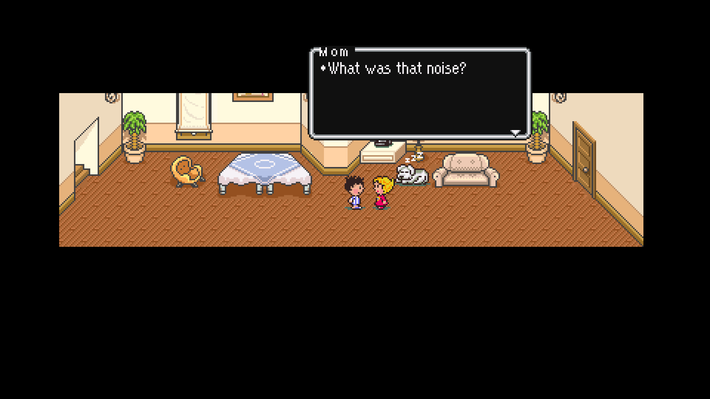

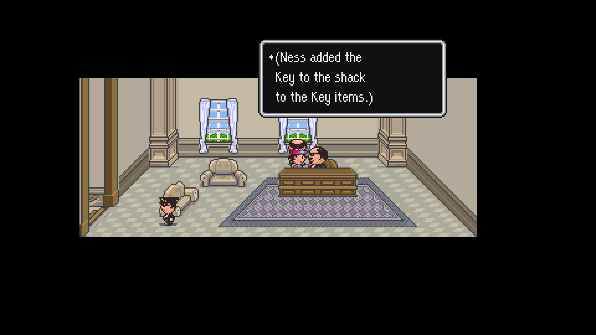

This capture replays the mayor’s actual Shack Key award using the production engine and ordinary recorded inputs. It is a story checkpoint, not a completed playthrough.

This 1080p capture uses locally supplied game data. It documents the development build; it is not proof of complete story compatibility.

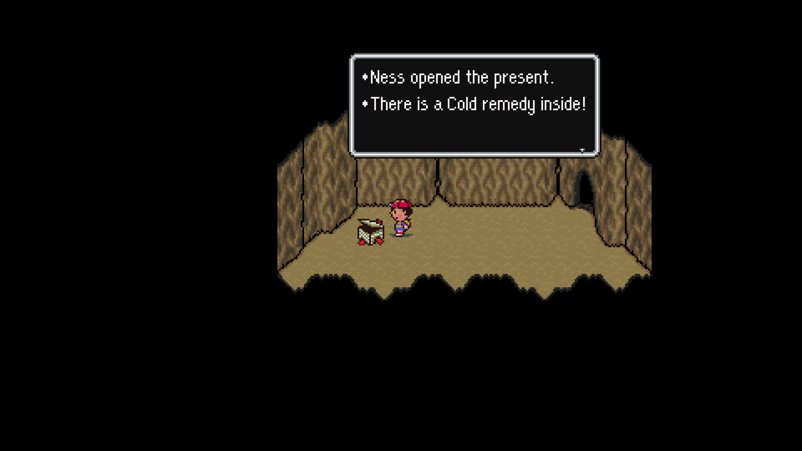

This production-engine capture shows the real present reward after the dev.5 fix. Testing also checks inventory, the opened flag and repeat protection.

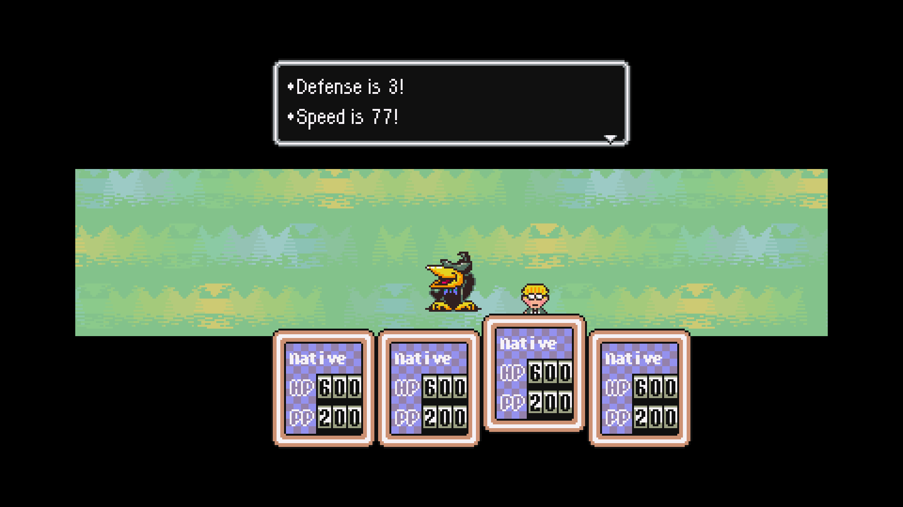

This unedited production-engine capture restores the added Speed message from the prepared four-member battle fixture. The debug character names and stats are fixture inputs; this is not ordinary story progress.

## What this is

EarthBound Companion packages a native x64 C/SDL2 game build with a self-contained Windows settings application. Gameplay executes as compiled native code; the optional SNES main-CPU verification emulator is disabled. Software implementations of the original graphics and SPC/DSP audio subsystems remain for rendering and sound.

The player-facing setup separates code/tools from player-supplied game data. Setup reads the owner's ROM locally and never modifies or uploads it. Conversion creates local working data and generated ROMs, removed after successful setup. Failed builds can retain private diagnostics and working files; those folders must not be uploaded.

**We still use the upstream native engine. This is an adaptation of that foundation, not a ground-up replacement.** The source lineage is [Herringway/ebsrc](https://github.com/Herringway/ebsrc) → [BrianPugh/earthbound](https://github.com/BrianPugh/earthbound) → [seanstaggsQU/earthboundRecompLinux2026](https://github.com/seanstaggsQU/earthboundRecompLinux2026) → Companion's pinned patch. Our launcher, Redux converters/adapters, PC integration, fixes, randomizer and recovery build on that work. Adding these features does not erase upstream authorship or licensing obligations. [Verified provenance](UPSTREAM.md) · [Full credits](CREDITS.md).

## Quick start

1. Download the Windows ZIP from the [latest official release](https://github.com/rages4calm/earthbound-companion/releases/latest). It supports Original EarthBound and MaternalBound Redux. [Other platforms](docs/PORTABILITY.md) use the community preview packages.
2. Extract the complete ZIP to a normal folder.
3. Run **EarthBound Companion.exe**.
4. Select your clean EarthBound (USA) `.sfc` or `.smc` ROM.
5. Leave **Install the complete MSU soundtrack** checked for enhanced music, or clear it to use SPC music. Internet access is needed for the pinned source and soundtrack downloads; testers need no Python, Git, .NET installation or compiler.
6. When setup finishes, choose **Play EarthBound**. **Game Mode** switches between Original EarthBound and MaternalBound Redux without changing either edition's saves.

The application accepts the clean 3 MiB USA ROM, with or without a 512-byte copier header. A different revision or modified ROM is rejected before extraction.

Before updating, close the game and launcher and back up the existing installation. Preserve `Profiles`, `UserData` and `msu`; review the target release notes before reusing development quick saves. Older content packs have specific upgrade/import routes described in [the conversion notes](MATERNALBOUND-NATIVE.md).

Switching editions selects a separate adventure; it does not convert an existing playthrough. Normal phone saves are the migration path between engine builds. Development quick saves require a compatible engine and state format.

## Where to go in the launcher

| Tab | Use it for |
|---|---|
| Play | Start or resume the normal story in the selected edition; choose a presentation/convenience preset. |
| Randomizer | Choose shuffle options, generate and replay seeds, open spoiler logs and manage each seed's separate saves. |
| Game Mode | Choose Original or Redux, choose the title screen, build game data or review conversion coverage. |
| Display | Resolution, fullscreen, widescreen framing, pixel filtering and visual effects. |
| Audio | MSU soundtrack selection/installation, music and game volume, and soundtrack credits. |
| Gameplay | Sprint, quick dialogue, homesickness/call settings, battle rewards and quick-save bank. |
| Controls | Keyboard/controller bindings, stick deadzone and face-button labels. |
| Mods & saves | Settings profiles, compatible native asset packs, and story-save backup/restore. |

Click **Apply settings** to save option changes. Game Mode selects the story edition played from Play. Randomizer's seed library manages randomized adventures and their saves.

## PC presentation notes

**HD means high-resolution output and enhanced presentation.** Converted pixel artwork is used; a replacement hand-drawn HD art pack is not included. Widescreen expands the native world view within the renderer's limits, rather than merely stretching the original picture. Physical controller play and every display/DPI combination have not been fully verified. Mod profiles tune supported native options; arbitrary ROM patches require explicit native adaptations.

## Native MSU soundtrack

First-run setup can download all 164 PCM tracks from [ShadowOne333’s EarthBound MSU-1 pack](https://archive.org/details/earthbound-msu-1-pack). Each file is checked against the embedded size and checksum manifest before it is installed. Interrupted setup keeps completed tracks; **Audio → Install / repair soundtrack** resumes and verifies the collection. Missing or invalid files fall back to the selected edition's SPC soundtrack. Native checks cover all 164 PCM loop/end boundaries, the eight Sound Stone transitions and retained SPC sound effects; complete listening and story-transition coverage remain unverified.

The PCM files are not stored in this repository or the release ZIP. See [CREDITS.md](CREDITS.md) for provenance.

## Story Shuffle v4

Companion includes its own native randomizer for replayable adventures:

- **Gift contents:** ordinary loot mixes across categories, including rare/priceless equipment, repairables and money gifts; keys, quest helpers and required pizza gifts stay fixed.
- **Shop stock:** ordinary occupied slots can change, including the first slot. Keys, quest helpers, empty slots and required Monkey Cave supplies stay fixed. Replacements have a nonzero original shop price; item prices are unchanged.
- **Enemy stats:** ordinary-enemy HP, offense, defense and speed vary within bounded ranges; bosses and scripted enemies stay fixed.
- **Enemy drops:** ordinary loot mixes across categories, including Cookies and regular enemies also used in scripted fights. Story drops, bosses, level-zero actors, drop odds and no-drop records stay fixed.
- **Wild encounters:** field encounters change to bounded ordinary lineups; map locations, spawn flags/odds/weights, group data and scripted boss lineups remain intact.
- Balanced and Surprise modes;
- deterministic seed recipes;
- isolated saves, screenshots and recovery backups for every seed.

Independent guards run at generation and before launch. Content ID, asset hash, safety policy, seed identity and save folder must agree. V4 protects actual keys, quest helpers and required trade sources instead of globally fixing every script-referenced item. Original story order, maps, doors, routes and scripts remain intact. These invariants do not certify a complete randomized campaign.

Four reviewed Original/Redux pack identities each pass 1,000 v4 seeds, 62 option/style combinations and corruption controls. Both editions have opening/cold-restore checks; 12 selected Redux lineups complete prepared encounters. V3 recipes retain their original algorithm, pack identity and separate saves; historical v3 protection counts do not describe v4. [Rules](RANDOMIZER.md) · [dev.32 evidence](docs/RELEASE-dev32.md).

This generator is inspired by the EarthBound randomizer community but does not claim seed parity with [earthbound.app](https://earthbound.app/) or [stochaztic/eb-randomizer](https://github.com/stochaztic/eb-randomizer). Ancient Cave, Open mode and Keysanity are not implemented. See [RANDOMIZER.md](RANDOMIZER.md).

## Current boundaries

- One user-reported Redux campaign reached Giygas and credits, with equipment/stat boosts for final testing. An automated or unboosted full campaign and full randomized progression are not certified.
- [MaternalBound Redux](https://github.com/ShadowOne333/MaternalBound-Redux) targets a pinned active-source snapshot, rather than the official v1.1 BPS release. Conversion includes 7,397 dialogue spans, 17 routine adapters and all 898 movement-script roots. Title scenes, 191 SPC tracks, 68 PSI effects, shops/equipment, all 11 battle Tools and all 32 photo-credit branches have bounded checks on the builds identified in their reports. Untested natural story branches, all combat-effect combinations and complete music-transition coverage remain unverified. See [detailed coverage](MATERNALBOUND-NATIVE.md).
- Arbitrary IPS, BPS and EBP patches cannot be loaded as native mods; their game-code changes require explicit ports.
- Windows 1.0.0 is the official release of the completed feature set; future updates focus on reported bugs. Include reproduction steps and relevant redacted lines from the active edition/seed session's `game.log`. Keep phone/quick saves locally; do not upload them to public issues. [Reporting guide](docs/COMMUNITY-TESTING.md).

## Source layout

| Path | Purpose |
|---|---|
| `Companion/` | .NET 8 Windows Forms launcher, settings, setup, backups and Story Shuffle source |
| `patches/native-companion.patch` | Exact native-engine changes against the pinned upstream commit |
| `scripts/Bootstrap-Native.ps1` | Fetches the upstream source and applies that patch |
| `scripts/` | Asset registry, progression audit, MSU verification and package-audit tools |
| `Mods/` | ROM-free example `.ebmod.json` profiles |
| `Licenses/` | Notices shipped with used dependencies |
| `validation/` | Bounded build, package and gameplay evidence |

## Building from source

The repository records the native foundation as a pin and patch rather than vendoring its entire tree. Bootstrap fetches the exact revision used by the release:

```powershell
git clone https://github.com/rages4calm/earthbound-companion.git
cd earthbound-companion
powershell -ExecutionPolicy Bypass -File .\scripts\Bootstrap-Native.ps1
```

Developers need a Windows x64 C toolchain, CMake/Ninja, SDL2 development files, Python and the .NET 8 SDK. Runtime builds use `EB_RUNTIME_ASSETS=ON`, `EB_ENABLE_VERIFY=OFF` and `EB_ENABLE_AUDIO=ON`. The native executable compiles without a ROM, extracted JSON or `ebtools`: numeric constants come from the checked-in assembly enums using Python 3.9+ standard-library code. Game setup still requires your own ROM to produce playable data. [Fresh dev.31 public-source build](validation/public-clean-source-dev31.json) · [Constants and loader proof](research/runtime-constants-final-manifest-dev16-v9.json). Redux setup-helper builds additionally require the pinned CoilSnake/CCScript toolchain and PyInstaller; see [the conversion instructions](MATERNALBOUND-NATIVE.md#reproducing-development-conversion).

For a code-only build after installing your toolchain, configure `native-source/port/unix` with the runtime flags above and your `SDL2_DIR`, then run `cmake --build` on that build directory. The loader fixture is deliberately excluded from the default build. For its separate test, install `ebtools`, run `python scripts/create_fixture.py`, then build the explicit `test_runtime_assets` target and execute it with the generated fixture pack and scratch paths. `Verify.ps1` records that sequence. It uses synthetic test data, not game JSON.

The checked-in rebuild/package scripts record the current workspace's tool paths; they are not a one-command provisioner for a fresh machine. Some historical commands refer to local `tools/` files, while published scripts live in `scripts/`. Put your own ROM at `ROM\EarthBound (USA).sfc`; `ROM/` is ignored by Git. Generated game data, build outputs, soundtracks, saves and runtime screenshots remain untracked; the labeled documentation screenshots are checked in.

## Legal and project status

EarthBound and Mother 2 are trademarks and copyrighted works of their respective owners. This is an unofficial fan project, not affiliated with or endorsed by Nintendo, Shigesato Itoi, APE, HAL Laboratory, or any rights holder. No ownership of the original game is claimed.

The October 4 review found no repository-wide redistribution grant in the reviewed native-foundation README/license files; GitHub also detects no top-level license. Third-party library licenses cover those libraries, not the whole engine. Public visibility and credits do not supply missing permission. [Review record](validation/upstream-license-provenance.json) · [GitHub's licensing guidance](https://docs.github.com/en/repositories/managing-your-repositorys-settings-and-features/customizing-your-repository/licensing-a-repository).

MaternalBound Redux and its adaptations have separate GPLv3 terms. Those terms do not license the native foundation. The combined engine's distribution and GPL compatibility remain unresolved in the recorded review despite the public development releases; repository visibility does not settle either issue. Original Companion files have their own [limited-scope license](LICENSE.md). A patch or compiled executable can still contain upstream material even when the full source tree is not vendored. See [LEGAL.md](LEGAL.md) and [CREDITS.md](CREDITS.md). No disclaimer claims to grant game rights or guarantee legal protection.

## Verification

Historical v0.4.0 and Redux setup evidence covers extraction, pack comparison, clean headered-ROM setup without installed Python/Git, soundtrack repair/verification, opening gameplay and save isolation on the releases named in those reports. Dev.32's unchanged native player/helpers retain their historical evidence; v4 checks cover four pack identities, each with 1,000 seeds and 62 combinations, plus focused native consumer/opening/encounter checks. Exact hashes and limits are in [validation/](validation/) and [dev.32 notes](docs/RELEASE-dev32.md). This documentation closeout did not rerun gameplay or replace the ZIP.

Issues and contributions should never attach ROMs, extracted asset packs, saves containing embedded game data, or soundtrack files. Documentation captures are labeled with their tested development scope.

## Community

[**R.A.I.D. — Retro AI Development**](https://discord.gg/Ad9BwSzctP) · a Discord for AI-assisted retro reverse-engineering, decomp & recomp.

I post all my projects and updates there. Join to discuss the games, share your work, or follow what I’m working on next.

### Reporting setup errors

If setup fails, choose **Save error report** (Windows setup dialog) or **Game & setup → Save setup error report** (Linux, macOS and Android). Attach the resulting `EarthBound-setup-report.txt` to your report. It includes the platform, launcher/runtime versions, setup progress and available helper tracebacks. Local home, installation and selected ROM paths are redacted; game files and saves are not attached. A copy is also saved as `UserData/setup-diagnostics.txt` when that folder is writable.
